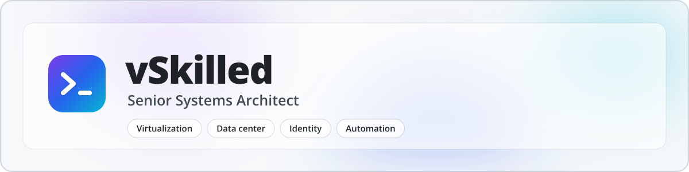

<picture>
  <source media="(max-width: 600px) and (prefers-color-scheme: dark)" srcset="assets/banner-compact-dark.svg">
  <source media="(max-width: 600px)" srcset="assets/banner-compact-light.svg">
  <source media="(prefers-color-scheme: dark)" srcset="assets/banner-dark.svg">
  
</picture>

  

### About Me

I'm a senior systems architect with over 18 years in enterprise infrastructure, systems administration and cloud. I design, migrate and run the platforms organizations can't afford to lose: virtualization, data centers, storage, DNS and identity.

I lead technical teams through mission-critical change, from architecture and planning to the overnight cutover, and I treat attention to detail as a requirement, not a preference.

### Core Competencies

- **Virtualization & HCI**: Design, upgrade and migrate VMware vSphere and Nutanix AHV estates, from cluster design and lifecycle upgrades to large-scale VM migrations, with Hyper-V and KVM where they fit.
- **Data Center & Migrations**: Plan and run multi-site moves and live cutovers around the business, with SAN and NAS storage design and Veeam backup and disaster recovery behind them.
- **Network Services & Identity**: Enterprise DNS, DHCP and IPAM on Infoblox, Active Directory and hybrid Entra ID, built for high availability so the basics keep answering.
- **Automation & Building**: PowerShell and PowerCLI for repeatable operations, Python for tooling, and web and hosting platforms built with TypeScript, Astro, Next.js and PHP.
- **AI-Assisted Engineering**: Hands-on with Claude Code, OpenAI Codex, Google Gemini and Meta Muse Code, orchestrated as one multi-agent fleet across hosts: routed delegation, shared guardrails and independent review on every change.

### How I work

- **Rollback first.** Every change ships with a tested way back.
- **Write it down.** Runbooks, diagrams and decision records that outlive the project.
- **Automate the second time.** Do it once by hand; script it before the third.
- **Calm under pressure.** Outages and overnight cutovers get a steady hand and clear communication.

### Toolbox

<table>
  <tr>
    <td><b>Virtualization &amp; HCI</b></td>
    <td>
      
      
      
      
    </td>
  </tr>
  <tr>
    <td><b>Cloud &amp; Edge</b></td>
    <td>
      
      
      
      
      
      
    </td>
  </tr>
  <tr>
    <td><b>Systems &amp; Identity</b></td>
    <td>
      
      
      
      
      
      
    </td>
  </tr>
  <tr>
    <td><b>Network, Storage &amp; DR</b></td>
    <td>
      
      
      
      
      
    </td>
  </tr>
  <tr>
    <td><b>Hosting Platforms</b></td>
    <td>
      
      
      
      
      
      
    </td>
  </tr>
  <tr>
    <td><b>Automation &amp; Code</b></td>
    <td>
      
      
      
      
      
      
      
      
      
    </td>
  </tr>
  <tr>
    <td><b>Delivery &amp; AI</b></td>
    <td>
      
      
      
      
      
      
      
      
      
    </td>
  </tr>
</table>

### Certifications

- **VMware vExpert** 2016, 2017, 2018, 2019
- VMware Certified Associate: Data Center Virtualization (VCA-DCV)
- VMware Certified Associate: Cloud (VCA-Cloud) and VTSP
- Microsoft Certified Professional: Windows Server 2016 Installation, Storage and Compute (70-740)
- Veeam Backup Academy Certified Professional
- Brocade Accredited Data Center Specialist
- Tintri Certified Systems Engineer
- Google AI Professional
- Diploma of Technical Studies, Information Systems Technology (BCIT)

### Homelab

Off the clock I run a full-blown multi-node homelab in a 32U server rack, where new automation and hosting stacks get tested before they reach production. It also runs the multi-agent AI fleet that builds and ships [karl.nyen.ca](https://karl.nyen.ca).

### Let's Work Together

Based in British Columbia, Canada. Open to senior roles and contract work, remote or hybrid.

